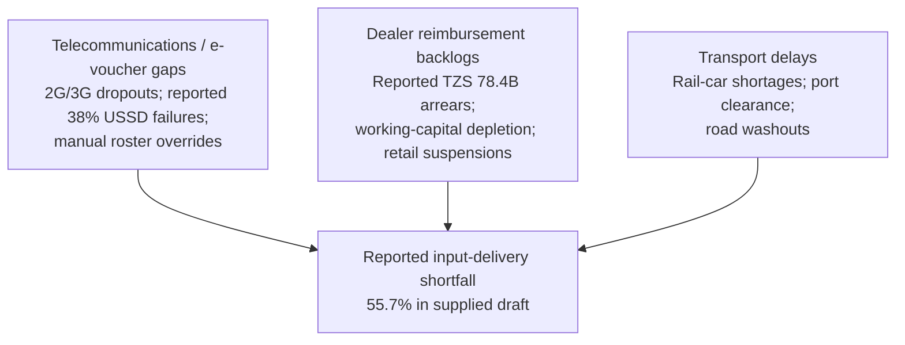

# Parliamentary Evidence Dossier: Agricultural Input Oversight

| Document detail | Information |
|---|---|
| **Document reference** | AB-COEBS-D3-2026 |
| **Date of presentation** | 11 November 2026 |
| **Prepared by** | Juma Jackson, Senior Parliamentary Research Analyst |
| **Presented to** | Parliamentary Standing Committee on Agriculture, Livestock and Water |
| **Jurisdiction** | Parliament of Tanzania (Bunge) |

> **Evidence-status notice:** The operational figures, legal interpretations, and programme claims in this draft are reproduced from the supplied text; they have not been independently corroborated. The two PDFs reviewed for this dossier—the *Statistical Abstract 2025* and the Ministry of Finance’s *Budget Execution Report for 2024/25*—do not report the beneficiary totals, voucher-failure rates, fertilizer-dealer arrears, NFRA physical stock, or 500,000-tonne statutory reserve threshold stated below. Treat these items as claims requiring documentary verification, not established findings.

## 1. Executive Callout — The Decision Anchor

The supplied draft describes a serious fertilizer-delivery shortfall in the Southern Highlands during the 2025/26 National Fertilizer Subsidy Programme. It claims that 1,050,000 of 2,370,000 registered smallholders received allocations, leaving 1,320,000 unserved—a reported delivery rate of 44.3%. It further projects a maize-output loss of 1.45 million tonnes, NFRA stocks of 182,000 tonnes against a claimed 500,000-tonne threshold, and an unhedged Treasury commitment of TZS 218.4 billion. **These figures and the asserted threshold have not been substantiated by the supplied PDFs.** If validated, they would warrant urgent scrutiny of seasonal delivery, dealer settlement, procurement, and reserve replenishment. The Committee should first require source records and a reconciled beneficiary-to-delivery ledger before relying on the estimates or characterizing the situation as a confirmed national crisis.

## 2. Strategic and Statutory Framework

### 2.1 Fertilizer Act No. 9 of 2009

The supplied draft attributes the following duties and requirements to the Fertilizer Act No. 9 of 2009 and related fertilizer-subsidy directives. These specific section references and interpretations should be checked against the current consolidated Act, regulations, and applicable programme instruments before being cited as legal conclusions.

1. **Regulatory stewardship (sections 4, 5, and 8(1), as cited in the draft).** The draft states that the Tanzania Fertilizer Regulatory Authority (TFRA) regulates fertilizer manufacture, importation, distribution, and pricing, and sets maximum indicative prices. It further attributes equitable-access and anti-hoarding duties to TFRA.
2. **Quality verification and consignment tracking (sections 12–16, as cited in the draft).** The draft describes mandatory batch sampling, port-of-entry certification, retail quality surveillance, and traceability from customs clearance to farmgate redemption.
3. **Agro-dealer licensing and consignment agreements (sections 21–24, as cited in the draft).** The draft states that registered agro-dealers distribute subsidized fertilizer under standardized tripartite agreements involving the Ministry of Agriculture and participating financial institutions. It characterizes unpaid verified dealer invoices as a breach of these arrangements; the relevant contracts and payment terms were not supplied for review.

The Act’s regulatory remit makes fertilizer quality, dealer oversight, storage, and transportation pertinent areas for committee scrutiny. The precise statutory duties and any alleged non-compliance should be established from the governing legal text and programme documents.

### 2.2 Alignment with FYDP III Key Result Area 2

The draft describes FYDP III (2021/22–2025/26) Key Result Area 2 as **“Deepening Industrialization and Service Provision”** and links it to agro-industrial self-sufficiency, rural productivity, and grain-processing value chains. It also attributes the following targets to the Plan:

- **Productivity:** Raising average smallholder maize yields from 1.8 to 3.5 tonnes per hectare through mineral fertilizer, including basal diammonium phosphate (DAP) and top-dressing urea.
- **Strategic grain reserves:** Maintaining an NFRA emergency reserve of 500,000 tonnes.
- **Domestic raw-material linkages:** Using domestic grain surpluses to support agro-processing and industrial grain milling.

The cited KRA wording, yield baseline and target, fertilizer linkage, and reserve target are not established by the two supplied PDFs. The Ministry should provide the relevant FYDP III results matrix, source pages, indicator definitions, and any separate legal instrument establishing a reserve threshold before these are presented as official targets.

## 3. Empirical Distribution Matrix

The figures below are reproduced from the supplied draft. Their cited source attribution could not be verified against the PDFs provided.

| Target administrative region | Registered smallholders | Serviced beneficiaries (redeemed vouchers) | Reported shortfall | Reported delivery rate |
|---|---:|---:|---:|---:|
| Ruvuma | 640,000 | 310,000 | 330,000 | 48.44% |
| Songwe | 480,000 | 195,000 | 285,000 | 40.63% |
| Mbeya | 520,000 | 245,000 | 275,000 | 47.12% |
| Iringa | 390,000 | 170,000 | 220,000 | 43.59% |
| Rukwa | 340,000 | 130,000 | 210,000 | 38.24% |
| **Consolidated total (as stated in draft)** | **2,370,000** | **1,050,000** | **1,320,000** | **44.30%** |

### Key findings asserted in the draft

- **Peripheral exclusion:** The draft identifies Rukwa as having the lowest reported delivery rate, at 38.24%, and attributes the shortfall to rural logistics and depot centralization.
- **Concentration of reported shortfalls:** It states that Ruvuma and Songwe together account for 615,000 unserved beneficiaries, or 46.6% of the consolidated deficit.
- **Execution variance:** The five listed regional delivery rates are all below 50%. The draft interprets this as a systemic problem across digital, financial, and logistics channels.

These are not independently validated findings. The regional arithmetic is internally consistent with the figures as supplied, but the beneficiary counts, redemption records, causes, and comparison basis require source records. “Consolidated total” should not be described as a national total unless coverage of all regions is confirmed.

## 4. Bottleneck Triangulation

The supplied draft attributes the reported delivery shortfall to three connected bottleneck areas. The audit reports, telecommunications maps, commercial manifests, and transaction-level evidence it references were not included in the materials reviewed.

### 4.1 E-voucher and telecommunications infrastructure

- **Cellular latency and USSD failures:** The draft says the m-Kilimo voucher platform uses USSD and SMS one-time-password authentication. It attributes coverage below 42% to audits in Ileje and Momba (Songwe) and Nkasi and Kalambo (Rukwa), and reports peak-hour transaction timeouts of 38.6%, including voucher deductions without inventory release. The cited audits, platform logs, and definition of coverage were not supplied.
- **Identity mismatches:** The draft reports National Identification Authority (NIDA) integration latency and approximately 214,000 mismatched or unregistered SIM credentials. It further alleges that dealers rejected transactions or used offline paper vouchers that TFRA later refused to honor. These figures and practices require transaction logs, exception records, and applicable programme rules.

### 4.2 Agro-dealer reimbursement and liquidity

- **Claimed state arrears:** The draft states that dealer claims total TZS 114.2 billion, of which TZS 35.8 billion was paid, leaving TZS 78.4 billion outstanding. It reports an average 142-day payment cycle against a 30-day settlement covenant. Claim schedules, payment records, and the contractual basis for the 30-day term were not provided.
- **Claimed working-capital contraction:** It reports that 412 of 728 licensed dealers (56.6%) suspended redemptions in October 2025, citing frozen bank facilities and interest penalties above 18% per annum. These claims require dealer-level records and confirmation from lenders and the regulator.

### 4.3 Logistics and bulk transportation

- **Rail capacity:** The draft attributes delays of up to 21 days to locomotive shortages and rail turnaround times, causing consignments to shift to road freight.
- **Port clearance:** It reports average Dar es Salaam bulk-fertilizer dwell time of 18.4 days in August–September and demurrage that raised landing costs by 12.3%.
- **Secondary freight:** It attributes feeder-road access problems in Iringa, Mbeya, and Ruvuma to pre-season rainfall and says 30-tonne vehicles could not reach some distribution points.

Port, rail, road, and delivery claims require dated shipment records, port and rail performance data, route-level dispatch records, and verified warehouse and farmgate receipts.

## 5. Strategic Policy Implications for Committee Interrogation

### 5.1 Macro-fiscal exposure

- **Contingent liabilities:** The draft characterizes the reported TZS 78.4 billion dealer balance as an unappropriated subsidy overhang and identifies possible interest, arbitration, and insolvency exposure. The amount, legal status, and liability treatment should be reconciled to audited claims and Treasury records.
- **Expenditure efficiency:** It states that TZS 138.6 billion was disbursed for input support but that failure to deliver a second urea tranche could undermine the impact of basal fertilizer expenditure. Budget lines, releases, procurement records, and evidence of delivery by tranche are needed to substantiate this concern.

### 5.2 Production and food-security risks

- **Yield-loss estimate:** The draft cites agronomic yield penalties of 1.1–1.35 tonnes of maize per hectare for plots lacking balanced basal and top-dressing fertilizer. Applying this range to 1.32 million unserved smallholders and 1.1 hectares per farmer, it estimates output losses of 1.45–1.78 million tonnes. The underlying model, population denominator, acreage assumption, and counterfactual were not supplied.
- **NFRA and price exposure:** The draft projects NFRA stocks of 182,000 tonnes, or 36.4% of a claimed 500,000-tonne requirement, and a 35–55% increase in urban wholesale maize prices. These projections require verified stock data, an authoritative reserve benchmark, procurement information, and a transparent market or price model.

### 5.3 Proposed summons and evidence schedule

The following proposed witnesses and records are based on the issues raised in the supplied draft. The Committee should confirm each office-holder’s current title and the appropriate summons authority and procedure.

| Proposed witness | Records and evidence requested |
|---|---|
| **Permanent Secretary, Ministry of Agriculture (Accounting Officer)** | Certified ledger of subsidy allocations and warrant disbursements for FY 2024/25–2025/26; operational audit of the m-Kilimo farmer registry; contingency plan for the relevant crop cycle. |
| **Executive Director, Tanzania Fertilizer Regulatory Authority (TFRA)** | Reconciliation of import manifests with verified farmgate redemptions; itemized outstanding, verified, and disputed dealer claims by region; evidence of price-cap enforcement and anti-hoarding actions. |
| **Chief Executive Officer, National Food Reserve Agency (NFRA)** | Current physical stock-verification audit across national storage facilities; Q3/Q4 domestic grain-purchasing allocations; reserve replenishment strategy and regional deficit mapping. |
| **Paymaster General / Permanent Secretary, Ministry of Finance** | Cash-flow allocation and exchequer-release schedule for agricultural budget lines; plan and timeline for reconciling and settling validated dealer claims. |
| **National Chairperson, Tanzania Agro-Dealers Association (TADA)** | Records supporting aggregate dealer overdraft exposure and debt status; inventory audit of unsold input stock held in secondary warehouses and associated voucher-system exceptions. |

The Committee should request source files in machine-readable form where available, with a consistent reporting date and unique identifiers linking registration, voucher redemption, dealer invoice, payment, dispatch, and farmer receipt.

## 6. Institutional AI Disclosure Notice

### Standard AB Consult disclosure protocol

The supplied draft states that the dossier was prepared by Parliamentary Research Services with the AB Consult Parliamentary AI Research Engine (AB-COEBS Model Series v4.2), using computational systems for document cross-referencing, data extraction, distribution reconciliation, and macro-yield scenario modelling. It also states that:

1. Extracted figures, voucher volumes, budget lines, and statutory citations were independently cross-checked and manually verified by the lead analyst.
2. No proprietary, sensitive parliamentary, or unreleased committee deliberations were uploaded to external or unvetted computational networks.
3. The lead researcher accepts responsibility for the analysis, statistical integrity, and recommendations.

The underlying verification records and the institutional protocol cited in the supplied disclosure were not provided for review. Accordingly, the disclosure should not be read as independent confirmation of the empirical or legal claims in this document. The lead researcher should confirm that the statements above accurately describe the work performed before publication.

---

**End of evidence dossier**
