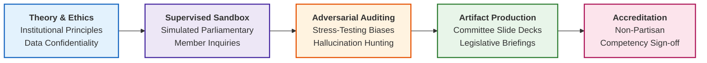
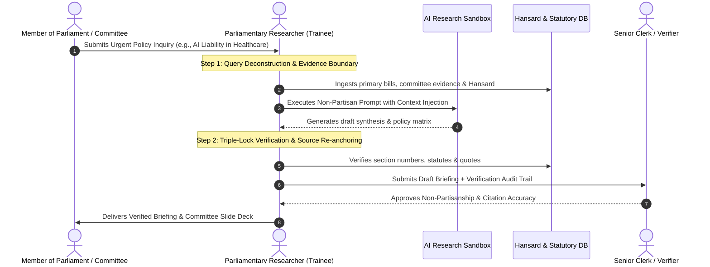

# 🏛️ AI for Parliamentary Research: Comprehensive Training & Operational Framework

[](#)
[](#)
[](#)
[](#)

A complete institutional training program and operational toolkit designed for **Parliamentary Research Services, Legislative Libraries, and Committee Secretariats**. This framework guides legislative staff from foundational AI literacy to advanced non-partisan policy analysis, synthetic legislative briefings, and verified slide deck generation.

---

## 📑 Table of Contents

- [Executive Summary & Training Mission](#-executive-summary--training-mission)
- [Pedagogical Architecture & Learning Philosophy](#-pedagogical-architecture--learning-philosophy)
- [Visual Training & Lab Workflow](#-visual-training--lab-workflow)
- [Comprehensive Training Curriculum](#-comprehensive-training-curriculum)
  - [Day 1 / Module 1: AI Foundations & the Legislative Context](#day-1--module-1-ai-foundations--the-legislative-context)
  - [Day 2 / Module 2: Non-Partisan Prompting & Bill Dissection](#day-2--module-2-non-partisan-prompting--bill-dissection)
  - [Day 3 / Module 3: Comparative Jurisdictional & Hansard Analysis](#day-3--module-3-comparative-jurisdictional--hansard-analysis)
  - [Day 4 / Module 4: The "Triple-Lock" Fact-Checking Protocol](#day-4--module-4-the-triple-lock-fact-checking-protocol)
  - [Day 5 / Module 5: Automated Presentation & Committee Deck Generation](#day-5--module-5-automated-presentation--committee-deck-generation)
- [Training Manuals & Guidance Suite](#-training-manuals--guidance-suite)
  - [1. Instructor Facilitation Handbook](#1-instructor-facilitation-handbook)
  - [2. Participant Lab Workbook](#2-participant-lab-workbook)
  - [3. Parliamentary Prompt Library](#3-parliamentary-prompt-library)
  - [4. Verification & Audit Checklist](#4-verification--audit-checklist)
- [Participant Competency & Evaluation Rubric](#-participant-competency--evaluation-rubric)
- [Automation & Presentation Utilities](#-automation--presentation-utilities)
- [Repository Structure](#-repository-structure)
- [Deployment & Workshop Setup](#-deployment--workshop-setup)

---

## 🏛️ Executive Summary & Training Mission

Parliamentary research is fundamentally distinct from academic or commercial research:
* **Time-Critical**: Members of Parliament (MPs) and Committees require rapid synthesis under tight legislative calendars.
* **Strictly Non-Partisan**: Outputs must never endorse policy or exhibit political bias; they must fairly present arguments on all sides.
* **High Institutional Stakes**: Erroneous citations or fabricated facts in Hansard or committee reports undermine democratic legitimacy.

This training program equips parliamentary staff to safely leverage Artificial Intelligence (AI) as an analytical co-pilot while enforcing strict human-in-the-loop evidentiary standards.

---

## 🧠 Pedagogical Architecture & Learning Philosophy

Our training follows an **Experiential Lab Model** (Learn $\rightarrow$ Simulate $\rightarrow$ Audit $\rightarrow$ Publish):



---

## 🔄 Visual Training & Lab Workflow

During practical training sessions, participants work through structured laboratory simulations mirroring real parliamentary deadlines:



---

## 📖 Comprehensive Training Curriculum

The course is organized into **five core training days** (or self-paced modules), each pairing theoretical grounding with a hands-on laboratory exercise using real-world legislative scenarios.

---

### Day 1 / Module 1: AI Foundations & the Legislative Context
> **Goal**: Demystify AI mechanics, instill data sovereignty protocols, and establish clear boundaries between generative creativity and legal fact.

* **Core Lecture Topics (3 Hours)**:
  - **Large Language Models (LLMs) Under the Hood**: Next-token prediction, temperature controls, context windows, and why LLMs can confidently hallucinate statutory provisions.
  - **Parliamentary Data Classification**: Public vs. Protected/Privileged parliamentary data; zero-data-retention environments; risk analysis of cloud APIs.
  - **The "Human-in-the-Loop" Mandate**: Institutional liability, parliamentary privilege, and authorial responsibility.
* **Hands-on Lab 1: "The Hallucination Trap"**:
  - *Exercise*: Trainees prompt an ungrounded model to summarize non-existent amendments to a national energy bill.
  - *Outcome*: Trainees document how convincing hallucinations appear and learn to identify unverified stylistic confidence.

---

### Day 2 / Module 2: Non-Partisan Prompt Engineering & Bill Dissection
> **Goal**: Master prompt patterns that extract and synthesize complex legislation into balanced, multi-perspective briefing papers.

* **Core Lecture Topics (3 Hours)**:
  - **The Non-Partisan Prompt Architecture**: Role definition, neutrality constraints, multi-stakeholder matrices, and dialectical synthesis.
  - **Clause-by-Clause Bill Deconstruction**: Prompting models to map legislative intents, regulatory powers, statutory definitions, and financial implications.
  - **Neutrality Guardrails**: Eliminating adjectives of praise/censure; equal-weight framing of government and opposition arguments.
* **Hands-on Lab 2: "The Controversial Legislation Lab"**:
  - *Scenario*: Analyzing a contentious Environmental Protection Bill.
  - *Exercise*: Trainees use the **Dialectical Prompt Template** to extract:
    1. Key legal mechanisms in Clauses 4 through 18.
    2. Proponents' economic and environmental arguments.
    3. Opponents' compliance costs, civil liberties, or federalism concerns.
    4. Comparative table of stakeholder submissions.

```text
┌────────────────────────────────────────────────────────────────────────┐
│               SAMPLE NON-PARTISAN PROMPT TEMPLATE                       │
├────────────────────────────────────────────────────────────────────────┤
│ [ROLE]        Senior Non-Partisan Legislative Analyst.                 │
│ [TASK]        Prepare an objective legislative summary of Bill X.       │
│ [SOURCE]      <<< PASTE CLAUSES 12-25 OF BILL >>>                      │
│ [CONSTRAINTS] 1. Neutral, dispassionate tone.                          │
│               2. Balanced section: Arguments in favor vs Concerns.     │
│               3. Attribute every claim to specific clause numbers.     │
│               4. Highlight any unassigned delegated powers.           │
│ [OUTPUT]      Markdown summary table + 300-word executive brief.       │
└────────────────────────────────────────────────────────────────────────┘
```

---

### Day 3 / Module 3: Comparative Jurisdictional & Hansard Analysis
> **Goal**: Utilize AI to synthesize parliamentary debate records (Hansard) and compare legislative approaches across global jurisdictions.

* **Core Lecture Topics (3 Hours)**:
  - **Hansard Debates Mining**: Extracting thematic consensus, member reservations, and committee questions from massive debate transcripts.
  - **Cross-Jurisdictional Mapping**: Comparing domestic legislation against international counterparts (e.g., UK House of Commons, Canadian Parliament, Australian Parliament, EU Directives).
  - **Normalizing Terminology**: Accounting for jurisdictional differences in legislative nomenclature (Acts, Statutory Instruments, Regulations, Orders-in-Council).
* **Hands-on Lab 3: "Cross-Commonwealth Policy Scan"**:
  - *Scenario*: A parliamentary committee requests a comparative note on how 4 different parliaments regulate automated vehicles.
  - *Exercise*: Ingesting statutory summaries from the UK, Canada, Australia, and New Zealand; using structured prompts to generate a harmonized comparative table.

---

### Day 4 / Module 4: The "Triple-Lock" Fact-Checking Protocol
> **Goal**: Transform trainees into rigorous evidentiary auditors capable of detecting subtle inaccuracies, outdated statutes, and misattributed quotes.

* **Core Lecture Topics (3 Hours)**:
  - **Evidentiary Hierarchy in Parliament**: Primary Statutes > Gazette Notices > Hansard > Official Inquiries > Peer-Reviewed Research > News Reports.
  - **The Triple-Lock Audit Methodology**:
    - **Lock 1 (Primary Grounding)**: Ensuring every factual assertion originates directly from supplied source text.
    - **Lock 2 (Index Verification)**: Manually checking bill section numbers, Gazette references, and court citations against primary portals.
    - **Lock 3 (Adversarial Verification)**: Asking the model to critique its own summary for omission of minority perspectives or unsupported inferences.
* **Hands-on Lab 4: "The Red-Team Challenge"**:
  - *Exercise*: Trainees receive an AI-drafted briefing note intentionally seeded with 5 subtle errors (1 fabricated citation, 2 misattributed quotes, 1 outdated statutory reference, and 1 partisan bias). Trainees must find and document all 5 using the **Audit Checklist**.

---

### Day 5 / Module 5: Automated Presentation & Committee Deck Generation
> **Goal**: Turn verified research briefings into clean, professional, high-impact slide decks for parliamentary committee hearings and MP briefings.

* **Core Lecture Topics (3 Hours)**:
  - **Executive Communication for Lawmakers**: Structuring 10-slide decks for time-constrained MPs (Scoping $\rightarrow$ Legislative Mechanics $\rightarrow$ Fiscal Impact $\rightarrow$ Key Trade-offs).
  - **Automation Utilities in this Repo**: Exploring `Scripts/generate_slide_deck.py`.
  - **Transforming Markdown to Slide Layouts**: Bullet density, font hierarchy, visual contrast, and institutional color palettes.
* **Hands-on Lab 5: "End-to-End Urgent Inquiry Simulation"**:
  - *Scenario*: At 09:00, a Committee Chair requests a 10-minute slide presentation for an afternoon hearing on "Artificial Intelligence in Public Procurement."
  - *Exercise*: Trainees ingest inquiry documents, run synthesis prompts, conduct the Triple-Lock check, execute `generate_slide_deck.py`, and deliver a completed slide deck by 12:00.

---

## 📁 Training Manuals & Guidance Suite

The repository contains four dedicated manuals to support trainers and participants:

```text
Manuals & Guidance Suite
├── 1. Instructor Facilitation Handbook (Pedagogical timing, setup, lecture slides)
├── 2. Participant Lab Workbook (Step-by-step exercises, fill-in templates)
├── 3. Parliamentary Prompt Library (50+ tested, non-partisan prompt patterns)
└── 4. Verification & Audit Checklist (Printable QA sheet for every draft briefing)
```

### 1. Instructor Facilitation Handbook
* **Format**: Structured guide for workshop facilitators.
* **Features**: Timed session outlines, sandbox configuration tips, common trainee stumbling blocks, and answer keys for all 5 lab exercises.

### 2. Participant Lab Workbook
* **Format**: Interactive markdown worksheets.
* **Features**: Contains scenario briefs, dirty input texts (Hansard raw cuts, bill drafts), prompt templates with blank variables, and self-check assessment quizzes.

### 3. Parliamentary Prompt Library
* **Format**: Ready-to-use prompt cards across standard parliamentary research genres:
  - *Bill Analysis Card*: Clause extraction and impact analysis.
  - *Hansard Digest Card*: Summarizing 4-hour second reading debates into 1-page summaries.
  - *Committee Inquiry Prep Card*: Generating probing, neutral questions for witness examinations.
  - *Budget Estimates Card*: Tabulating program appropriations and multi-year variances.

### 4. Verification & Audit Checklist
* A single-page, high-stakes quality control instrument that must accompany every research output before it is delivered to an MP or Committee.

---

## 📊 Participant Competency & Evaluation Rubric

Trainees are evaluated against four institutional competencies:

```mermaid
quadrantChart
    title Trainee Competency Evaluation Matrix
    x-axis Low Technical Fluency --> High Technical Fluency
    y-axis Low Evidentiary Rigor --> High Evidentiary Rigor
    quadrant-1 Certified Parliamentary AI Specialist
    quadrant-2 Diligent Verifier (Needs Speed Coaching)
    quadrant-3 Non-Compliant / High Institutional Risk
    quadrant-4 Dangerous Producer (High Speed, High Hallucination)
```

| Competency Dimension | Novice (Level 1) | Proficient (Level 2) | Certified Specialist (Level 3) |
| :--- | :--- | :--- | :--- |
| **Non-Partisanship** | Shows subtle bias in adjective choices; single-perspective focus. | Balanced presentation of major political viewpoints. | Impeccable dialectical framing; captures minority & regional stakeholder nuances. |
| **Prompt Engineering** | Uses generic queries ("Explain Bill X"). | Uses structured multi-step role/constraint prompts. | Designs complex chain-of-thought workflows with explicit verification hooks. |
| **Citation Rigor** | Accepts generated citations at face value. | Spots obvious errors; checks primary sources periodically. | Employs systematic Triple-Lock audit; 100% verified against Hansard & Statute databases. |
| **Output Delivery** | Raw unformatted text dumps. | Clean markdown briefings with standardized tables. | Automated production of publication-ready notes and executive slide presentations. |

---

## 🛠️ Automation & Presentation Utilities

The repository includes automation scripts designed to bridge the gap between text briefings and executive presentations.

### `Scripts/generate_slide_deck.py`
This script takes structured research outputs and compiles them into clean, standardized slide presentations suitable for parliamentary hearings.

#### Key Features:
- **Automatic Layout Selection**: Selects optimal slide archetypes (Title, 2-Column Pros/Cons, Timeline, Key Metrics, Stakeholder Matrix).
- **Institutional Themes**: Formats colors and typography conforming to parliamentary visual standards.
- **Strict Content Density**: Enforces the 6x6 rule (maximum 6 bullets, 6 words per bullet) to ensure presentations remain readable during live committee proceedings.

```bash
# Example Command:
python3 Scripts/generate_slide_deck.py \
  --input Examples/sample_ai_procurement_brief.json \
  --theme parliamentary_navy \
  --output Outputs/committee_briefing_deck.pptx
```

---

## 📂 Repository Structure

```text
AI-Research-for-Parliamentary-Research/
├── README.md                           # Main training overview & documentation
├── Manuals/                            # Core training manuals
│   ├── Instructor_Handbook.md         # Workshop facilitator guide & lab answer keys
│   ├── Participant_Workbook.md        # Hands-on exercises for trainees
│   └── Prompt_Engineering_Manual.md   # Non-partisan prompt methodology
├── Guidance/                           # Quick reference cards & checklists
│   ├── Prompt_Library.md              # 50+ vetted parliamentary prompts
│   ├── Verification_Checklist.pdf     # Printable quality control audit sheet
│   └── Style_and_Tone_Guide.md        # Neutrality guidelines & phrasing lexicon
├── Labs/                               # Practical exercise files
│   ├── Lab1_Hallucination_Trap/       # Ingest data & seeded text for Lab 1
│   ├── Lab2_Controversial_Bill/       # Bill excerpts & stakeholder briefs for Lab 2
│   ├── Lab3_Comparative_Scan/         # 4-jurisdiction legal texts for Lab 3
│   ├── Lab4_Red_Team_Audit/           # Error-seeded briefing note for Lab 4
│   └── Lab5_Urgent_Inquiry/           # Simulated fast-response inquiry for Lab 5
├── Scripts/                            # Operational automation
│   ├── generate_slide_deck.py         # Briefing-to-presentation generator
│   └── verify_statutes.py             # Script to validate citation patterns
├── Templates/                          # Standardized document templates
│   ├── briefing_note_template.md      # Parliamentary research paper format
│   └── committee_deck_schema.json     # Schema for slide deck generation
└── Examples/                           # Fully completed reference outputs
    ├── Completed_Briefing_Sample.md   # Gold-standard policy briefing
    └── Sample_Committee_Deck.pdf      # Example output of generate_slide_deck.py
```

---

## 🚀 Deployment & Workshop Setup

### Facilitator Quick Start
1. **Clone the Project**:
   ```bash
   git clone https://github.com/your-parliament/AI-Research-for-Parliamentary-Research.git
   cd AI-Research-for-Parliamentary-Research
   ```
2. **Environment Setup**:
   ```bash
   python3 -m venv .venv
   source .venv/bin/activate
   pip install -r requirements.txt
   ```
3. **Verify Slide Generation Script**:
   ```bash
   python3 Scripts/generate_slide_deck.py --test
   ```
4. **Conduct Pre-Workshop Readiness**:
   - Ensure all participant workstations have access to the local sandbox or compliant enterprise LLM portal.
   - Print or distribute digital copies of `Guidance/Verification_Checklist.pdf`.

---

## 📜 Ethical Commitment & Non-Partisanship Pledge

All materials in this repository adhere to the **International Guidelines on Parliamentary Research**:
- We hold that AI must augment, never replace, the independent critical discernment of parliamentary researchers.
- We affirm that democratic accountability requires transparent, traceable evidence for every claim placed before elected representatives.