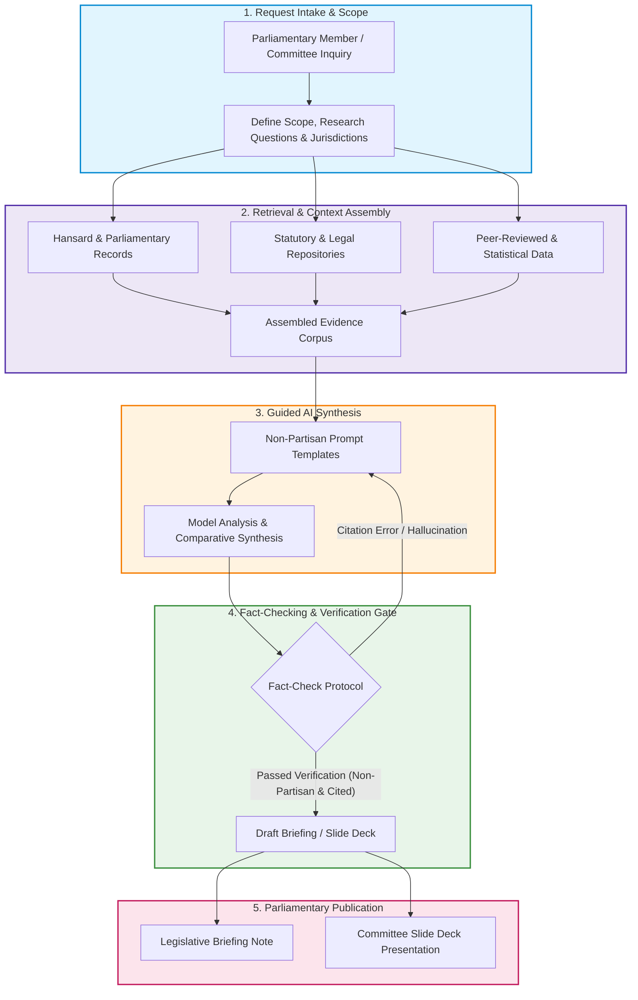
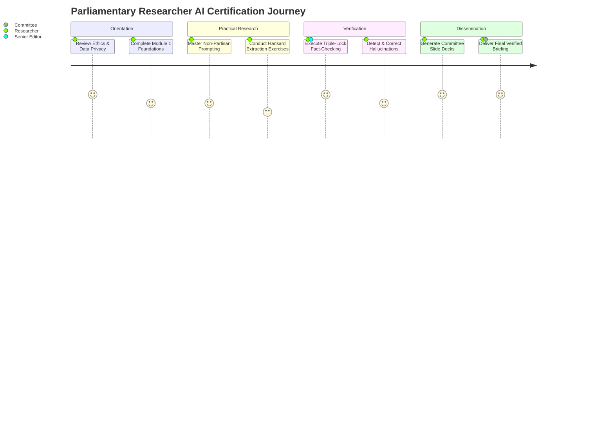

# 🏛️ AI Research for Parliamentary Research Services

[](#)
[](#)
[](#)
[](#training-manuals--guidance-suite)

A standardized research, training, and automation framework designed to empower **Parliamentary Libraries, Research Directorates, and Legislative Staff** to responsibly, objectively, and effectively adopt Artificial Intelligence (AI) technologies.

---

## 📑 Table of Contents

- [Overview & Purpose](#-overview--purpose)
- [System Architecture & Workflow](#-system-architecture--workflow)
- [Training Manuals & Guidance Suite](#-training-manuals--guidance-suite)
  - [Module 1: Foundations of Parliamentary AI](#module-1-foundations-of-parliamentary-ai)
  - [Module 2: Non-Partisan Prompt Engineering Manual](#module-2-non-partisan-prompt-engineering-manual)
  - [Module 3: Fact-Checking & Hallucination Mitigation Guide](#module-3-fact-checking--hallucination-mitigation-guide)
  - [Module 4: Automated Slide Deck & Briefing Generation](#module-4-automated-slide-deck--briefing-generation)
  - [Module 5: Ethical Governance & Data Sovereignty](#module-5-ethical-governance--data-sovereignty)
- [Learning Pathways](#-learning-pathways)
- [Repository Structure](#-repository-structure)
- [Quick Start Guide](#-quick-start-guide)
- [Quality Assurance & Verification Matrix](#-quality-assurance--verification-matrix)
- [Contributing & Maintenance](#-contributing--maintenance)

---

## 🌐 Overview & Purpose

Parliamentary research demands **unimpeachable accuracy, non-partisanship, transparency, and stringent citation standards**. This repository provides the complete operational blueprint:
1. **Interactive Training Manuals**: Step-by-step guidance for research analysts and parliamentary clerks.
2. **Quality Assurance Protocols**: Methodologies to cross-examine AI outputs against Hansard, legislative databases, and verified empirical studies.
3. **Automated Production Tools**: Python scripts to transform structured policy inquiries into briefings and slide decks for parliamentary committees.

---

## 🔄 System Architecture & Workflow

The diagram below details the operational cycle for conducting AI-assisted parliamentary research:



---

## 📚 Training Manuals & Guidance Suite

The training curriculum is structured into **5 distinct manuals**, designed for self-paced learning and workshop delivery.

| Manual / Module | Target Audience | Primary Focus | Key Deliverable |
| :--- | :--- | :--- | :--- |
| **[Module 1: AI Foundations](#module-1-foundations-of-parliamentary-ai)** | All Staff & Researchers | AI concepts, capabilities, limitations | Conceptual grounding & literacy |
| **[Module 2: Prompt Engineering](#module-2-non-partisan-prompt-engineering-manual)** | Research Analysts | Prompting patterns, multi-perspective summaries | Production-ready prompt library |
| **[Module 3: Verification & Rigor](#module-3-fact-checking--hallucination-mitigation-guide)** | Fact-Checkers & Senior Researchers | Primary source reconciliation, hallucination detection | Verification checklists & audit trails |
| **[Module 4: Automated Decks & Reports](#module-4-automated-slide-deck--briefing-generation)** | Technical Staff & Analysts | Scripting, slide generation, visual assets | Executive presentation slide decks |
| **[Module 5: Governance & Ethics](#module-5-ethical-governance--data-sovereignty)** | Clerks & Directorates | Confidentiality, bias mitigation, institutional safety | Governance & compliance protocols |

---

### Module 1: Foundations of Parliamentary AI
* **Objective**: Establish shared baseline knowledge of Generative AI, Large Language Models (LLMs), and Retrieval-Augmented Generation (RAG).
* **Key Topics**:
  - Distinguishing between generative creativity and deterministic factual recall.
  - Why standard consumer AI cannot replace primary statutory databases.
  - Institutional confidentiality when interacting with hosted APIs vs. local models.

---

### Module 2: Non-Partisan Prompt Engineering Manual
* **Objective**: Train researchers to construct prompts that guarantee balanced, multi-perspective policy synthesis.
* **Core Framework**:
  ```text
  [ROLE]       Act as a Senior Non-Partisan Parliamentary Research Analyst.
  [CONTEXT]    Summarizing Bill C-XX / Legislative Act for parliamentary committee review.
  [EVIDENCE]   Input primary evidence text from [Official Source / Hansard].
  [CONSTRAINT] Maintain strictly neutral tone; outline primary arguments FOR and AGAINST; cite section numbers.
  [OUTPUT]     Executive summary table followed by detailed comparative analysis.
  ```
* **Practicum**: Transforming adversarial political debates into neutral, evidence-weighted briefs.

---

### Module 3: Fact-Checking & Hallucination Mitigation Guide
* **Objective**: Zero-tolerance protocols for unverified citations, fabricated case law, and misattributed statistics.
* **The "Triple-Lock" Verification Process**:
  1. **Lock 1 - Source Anchoring**: Never accept an ungrounded claim without an attached primary document URL or record ID.
  2. **Lock 2 - Reverse Verification**: Every cited Hansard volume or legal precedent must be cross-checked against the legislative index.
  3. **Lock 3 - Human Attribution**: AI is a drafting assistant; final attribution and responsibility rest entirely with the human researcher.

---

### Module 4: Automated Slide Deck & Briefing Generation
* **Objective**: Automating the rendering of executive slide decks using internal repository scripts.
* **Script Location**: `Scripts/generate_slide_deck.py`
* **Features**:
  - Ingests structured markdown research briefs or JSON data.
  - Automatically structures agendas, core policy questions, stakeholder matrices, and statistical visuals.
  - Outputs standardized presentations ready for parliamentary committee hearings.

```bash
# Run the slide deck generator
python3 Scripts/generate_slide_deck.py --input data/sample_briefing.json --output outputs/committee_presentation.pptx
```

---

### Module 5: Ethical Governance & Data Sovereignty
* **Objective**: Protect parliamentary privilege, constituent data, and institutional impartiality.
* **Key Guidelines**:
  - Never input unreleased committee deliberations, draft legislation, or constituent correspondence into public cloud AI endpoints.
  - Maintain an auditable log of AI-assisted publications when required by legislative transparency policies.

---

## 🗺️ Learning Pathways



---

## 📂 Repository Structure

```text
AI-Research-for-Parliamentary-Research/
├── README.md                           # Main repository entrypoint and documentation
├── Manuals/                            # Training manuals & pedagogical materials
│   ├── 01_AI_Foundations.md           # Module 1: Core concepts and terminology
│   ├── 02_Prompt_Engineering.md       # Module 2: Prompt templates & patterns
│   ├── 03_Fact_Checking_Guide.md      # Module 3: Verification & audit protocols
│   ├── 04_Slide_Generation_Guide.md   # Module 4: Deck automation manual
│   └── 05_Ethics_and_Governance.md    # Module 5: Impartiality & data security
├── Guidance/                           # Quick reference sheets & checklists
│   ├── prompt_cheat_sheet.md          # 1-page quick prompt builder
│   ├── verification_checklist.pdf     # Printable researcher verification checklist
│   └── style_guide.md                 # Parliamentary tone & non-partisanship guide
├── Scripts/                            # Automation utilities
│   ├── generate_slide_deck.py         # Slide deck generator script
│   └── verify_citations.py            # Citation validation helper
├── Templates/                          # Standardized templates
│   ├── briefing_note_template.md      # Policy briefing document template
│   └── committee_deck_template.json   # Input schema for slide generation
└── Examples/                           # Annotated case studies & sample outputs
    ├── bill_analysis_sample.md        # Sample non-partisan bill breakdown
    └── sample_presentation.pdf        # Example output deck
```

---

## 🚀 Quick Start Guide

### 1. Prerequisites
- Python 3.10 or higher
- Standard virtual environment tools (`venv` or `uv`)

### 2. Setup Workspace
```bash
# Clone the repository
git clone https://github.com/your-parliament/AI-Research-for-Parliamentary-Research.git
cd AI-Research-for-Parliamentary-Research

# Create and activate virtual environment
python3 -m venv .venv
source .venv/bin/activate

# Install dependencies for slide generation & verification tools
pip install -r requirements.txt
```

### 3. Generate Your First Committee Slide Deck
```bash
python3 Scripts/generate_slide_deck.py --help
```

---

## 🛡️ Quality Assurance & Verification Matrix

Before publishing any AI-assisted parliamentary document, verify compliance across all five institutional criteria:

| Quality Criterion | Standard | Verification Check | Status |
| :--- | :--- | :--- | :---: |
| **Objectivity** | Balanced, neutral, avoids policy endorsement | Multi-perspective validation performed | `REQUIRED` |
| **Citation Traceability** | 100% of figures and legal references verified | Hansard / Statutory citation verified | `REQUIRED` |
| **Clarity** | Plain language accessible to MPs and public | Readability index evaluated | `REQUIRED` |
| **Confidentiality** | No sensitive parliamentary data transmitted | Air-gapped / Local execution confirmed | `REQUIRED` |
| **Human Sign-off** | Certified by accredited researcher | Author sign-off on record | `REQUIRED` |

---

## 🤝 Contributing & Maintenance

We welcome improvements to our training modules, prompt templates, and generation scripts from parliamentary researchers and digital services teams:
1. Fork this repository.
2. Create a descriptive feature branch (`git checkout -b feature/module3-case-studies`).
3. Commit your updates and open a Pull Request with an explanation of educational value.